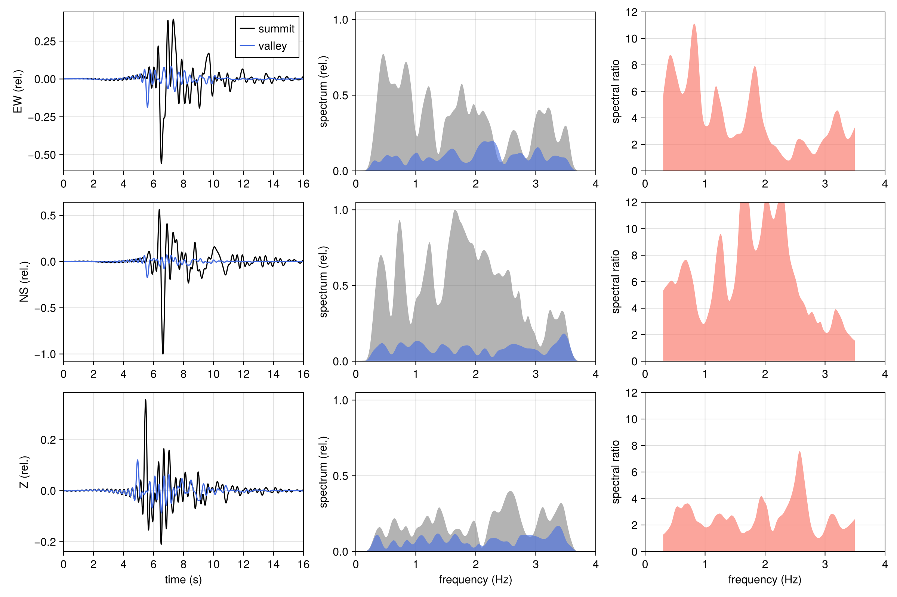
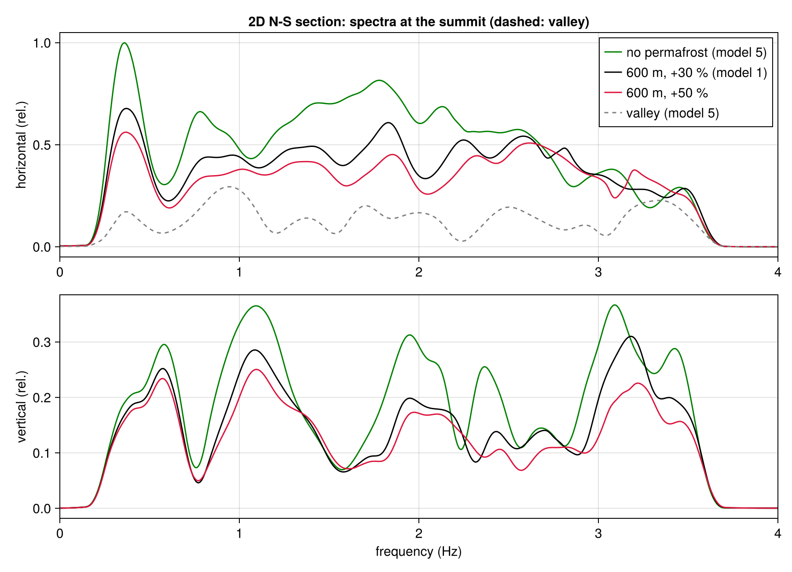

# The Matterhorn: topographic amplification of seismic waves

A reproduction of the simulations of Limberger, Rümpker, Kruse & Duretz (2025), *Modeling earthquake-induced wavefields
and stresses in alpine mountains with extreme topography*, Sci. Rep. 15, 23914, doi:10.1038/s41598-025-08218-5 (Salvus,
spectral elements), with the curvilinear SBP solver of SeismicWavePC.

```
julia --project=examples/matterhorn -e 'using Pkg; Pkg.instantiate()'
julia -t auto --project=examples/matterhorn examples/matterhorn/matterhorn_3d.jl metal 0.06   # 3D runs (Metal GPU; or cpu)
julia --project=examples/matterhorn examples/matterhorn/analyze_3d.jl 60m                     # Figs. 2, 4, 5
julia -t auto --project=examples/matterhorn examples/matterhorn/matterhorn_fig7.jl             # Fig. 7 (2D)
julia -t auto --project=examples/matterhorn examples/matterhorn/matterhorn_2d.jl               # Fig. 6 (2D, permafrost)
```

The DEM (swissALTIRegio, 10 m, swisstopo; 9 tiles of 10 km) is downloaded on the first run into `examples/data/`, as are
the cached results.

## Model (as in the paper, and where it differs)

- **Topography:** swissALTIRegio (the paper's DEM), Gaussian-smoothed (σ = 40 m), real within 5 km of the summit (the
  paper's 10 km × 10 km), blended to a flat surface at 2.95 km (the mean height around it) between 5 and 6.5 km. *The
  paper's DEM reaches its absorbing boundaries; here the plane wave is injected along a box (total-field/scattered-field,
  `TeleseismicWave`) whose sides must lie in flat, laterally homogeneous ground.*
- **Material:** vp from 3 km/s at the summit (4478 m) linearly to 6 km/s at −2 km, vs = vp/1.7, Qp = 200, Qs = 100;
  density 2600–3000 kg/m³ in the same way (the colour scale of Fig. 1; the text gives no density). *Q fades out within
  ~1 km of the injection box, which must be elastic.*
- **Plane wave:** vertical (and in 2D 45°) P and S waves from below. *The paper excites them at once with x, y, z forces
  on the z = 0 plane; here one wave per run (P, S polarized NS, S polarized EW), summed as P + 1.7 S (in velocity, a
  force sends an S wave vp/vs times stronger than a P wave). The polarity of S relative to P is not given in the paper.*
- **Source wavelet:** the Ormsby wavelet flat between 0.3 and 3.5 Hz (Fig. S1; corners 0.2, 0.3, 3.5, 3.65 Hz), and a
  0.4 Hz Ricker wavelet for the map. *In 3D the runs use a Gaussian pulse (energy up to ~4 Hz) and the Ormsby and Ricker
  responses follow by spectral division; in 2D (Fig. 7) the Ormsby wavelet is the incoming velocity directly.*
- **Mesh:** terrain-following, columns vertical, rows flat below −1.5 km (for the injection box), 7th-order upwind SBP
  operators; PML around.

## Results

**3D (Figs. 2, 4, 5 of the paper):** a 60 m grid (290 × 290 × 141 = 11.9 M nodes, about 8 points per S wavelength at
3.5 Hz at the summit, as the paper's 2 elements of order 4 per wavelength), 25 s, dt = 1.29 ms (19318 steps), Float32 on
an Apple M4 Max GPU (Metal): 15 min per incoming wave. Summit: the highest point; valley: the south end of the NS profile
(2.5 km south, 2.6 km high; the rectangle in Fig. 2B of the paper). Spectral ratios of spectra smoothed over ±0.1 Hz.

| | paper | here (60 m) |
|---|---|---|
| summit spectral peaks | 0.4 Hz (NS), resonances 0.4–2.5 Hz | 0.42 Hz (NS), 0.46 Hz (EW); further 0.64–2.5 Hz |
| largest spectral ratio | ~11 on NS at 0.4 Hz | NS 5.9 at 0.4 Hz (14 at 1.66 Hz); EW 8.6 at 0.4 Hz (11 at 0.82 Hz) |
| EW minor peak | 1.8 Hz | 1.8 Hz (ratio 7.6–7.9) |
| vertical | subdued | ratio ≤ 7.6 (2.6 Hz), ~2 below 2 Hz |
| summit/valley PGV (time domain) | ~3 (Fig. 4A) | EW 3.0, NS 5.8, Z 3.0 |
| amplification map, 0.4 Hz Ricker | maximum at the summit, ridges lower | maximum 8.2× (relative to the minimum) at the summit; ridges and Dent d'Hérens 2–4× |



The fundamental modes agree with the paper and with the ambient-noise measurements of Weber et al. (2022): two
orthogonal modes near 0.42 Hz. Which horizontal component shows the larger 0.4 Hz ratio depends on the valley spectrum
(the station sits on a slope itself) and on the relative polarity of the P and S waves, which the paper does not give.
At 100 m (5 points per wavelength at 3.5 Hz) the low-frequency numbers are the same (0.41/0.46 Hz; ratios at 0.4 Hz within
~25 %), the high-frequency ones (PGV, the 1.6–2 Hz NS ratios) are not yet converged.

**Validation:** with a flat surface (the same pipeline, 100 m) all summit/valley spectral and PGV ratios are 1.00, and the
plane wave arrives with the impedance-corrected amplitude (√(ρ₆ vp₆/ρ vp) = 1.30 × twice the incoming wave) to 0.5 % (P) and
2 % (S) across the surface.

**2D N-S section, permafrost (Fig. 6):** 40 m grid, 86 k nodes, CPU. Summit horizontal spectrum peaks at 0.36 and 1.45 Hz
(paper: 0.4 and 1.4 Hz). A permafrost cap (velocities × 1.3, density × 1.1, 600 m thick below the summit, thinning to 0 at
2.9 km) lowers the fundamental peak by 32 % and the 1.4 Hz peak by 30 %; with velocities × 1.5 by 44 % and 41 % (paper: up to
~30 %, Fig. 6C, for 600 m and +50 %; its permafrost geometry is only shown as a sketch).


